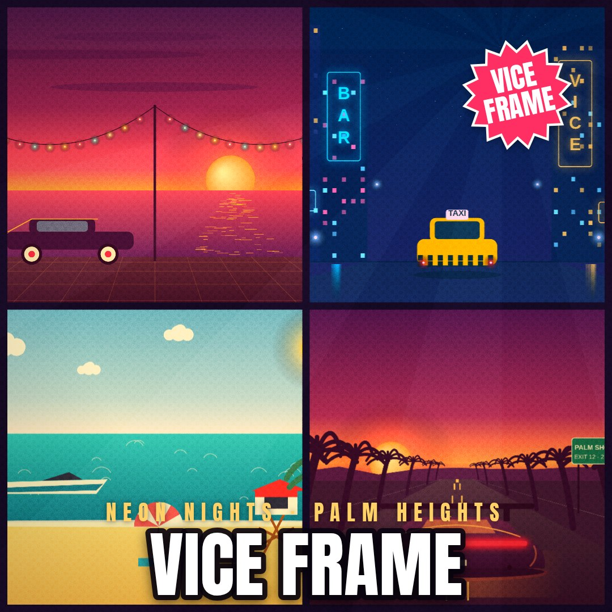

[](https://make.fun/bounty/gta6-cover-art-01?utm_source=github&utm_medium=readme&utm_campaign=gta6-cover-art-01)
[](https://make.fun/bounty/gta6-cover-art-01/leaderboard?utm_source=github&utm_medium=readme&utm_campaign=gta6-cover-art-01)
[](https://make.fun/bounty/gta6-cover-art-01?utm_source=github&utm_medium=readme&utm_campaign=gta6-cover-art-01)

# Vice Frame 4

An offline GTA-style cover-art maker, built for the make.fun bounty
[gta6-cover-art-01](https://make.fun/bounty/gta6-cover-art-01). Turn
illustrated scenes or your own photos into multi-panel cover art with
poster lettering, and export it as a PNG — no account, no uploads, no
network: everything runs in the page, from files in this repository.



## Run it

```sh
node serve.ts            # then open http://localhost:8080
```

Node 22, standard library only. Or open `app/index.html` through any static
file server. To hand the entry in the way the grader does:

```sh
mkdir -p out && MAKEFUN_OUTPUT_DIR=out node main.ts
```

which copies `app/` and `screenshots/` to the output directory and writes
`dossier.json` there.

## What it does

- **Six templates** — Vice Grid (2×2), Hero & Three, full-bleed Poster,
  Tilted Snapshot (framed prints over a blurred backdrop), Cover Lines (a
  magazine rail with an editable headline strip), and The Slash (a diagonal
  two-panel split).
- **Five illustrated scenes**, painted procedurally on a 1920×1200 canvas
  with a seeded random generator, so they render identically every load:
  Sunset Pier (festoon lights, a lowrider), Neon Boulevard (glowing signs,
  a taxi), Beach Day (speedboat, lifeguard tower), Downtown Dusk (layered
  towers, a helicopter crossing the sun) and Palm Highway (a sports car
  under a full-width tail-light bar). Plus two bundled sample photos, and
  your own photos via the picker or drag & drop (up to four panels).
- **Six colour grades** — Sunset, split-tone Neon Nights, Golden Hour,
  Miami Pastel, Noir and Raw — applied per channel with split toning. The
  cover has one grade, and **each panel can override it with a grade of its
  own**, which is how the collage covers mix a neon panel beside a golden
  one.
- **Poster lettering** in Anton (vendored, SIL OFL — see
  `app/fonts/OFL.txt`): caption and letter-spaced subtitle in four themes —
  Blockbuster, Neon Sign, Gold Foil and Stencil.
- **Badge & banner layer** — a 16-spike starburst badge with editable
  two-line text and a −40°…+40° tilt slider, and an optional bottom banner
  strip; the caption moves up to make room for it.
- **Finishing controls** — sunburst, halftone, grain and vignette sliders.
- **Panel crafting** — click a panel to select it, drag on the cover to
  reframe its crop, scroll to zoom, or use the per-panel zoom slider.
- **Surprise me** — one click deals one of ten curated combinations of
  template, scenes, harmonising per-panel grades and lettering.
- **Undo / redo** for everything (buttons, Ctrl+Z / Ctrl+Shift+Z / Ctrl+Y),
  with rapid slider drags and typing folded into single steps.
- **Exports** at 1080×1080, 1080×1350 and 1920×1080. The preview and the
  export are the same render, so what you see is the PNG you get.

Everything is original: the scenes, signs, places and vehicles are invented
for this app, and no third-party artwork or fonts are used. The only
vendored code is the kit's `vendor/makefun-app.ts`, which builds the
dossier.

## How it is put together

| File | What it holds |
| --- | --- |
| `app/src/features.js` | The feature catalogue (templates, grades, scenes, lettering themes, export sizes) as one JSON document the app and `main.ts` both read |
| `app/src/scenes.js` | The five procedural scene painters |
| `app/src/grades.js` | The colour grades (per-channel LUTs + split tone + saturation) |
| `app/src/templates.js` | The six layout geometries |
| `app/src/render.js` | The cover renderer: panels, finishes, lettering, badge, banner |
| `app/src/state.js` | Editor state, undo/redo history, the Surprise-me combos |
| `app/src/main.js` | The editor: controls, panel list, canvas gestures, exports |
| `app/src/shots.js` | Builds a fixed state from a `?shot=` URL for screenshots |
| `main.ts` | The entrypoint: hands in the app, then extends `dossier.json` with the feature manifest and per-template statistics it reads from `features.js` (also written to `feature-manifest.json`) |
| `shots.json` | The four screenshots in `screenshots/`, each a URL of the real app |

The screenshots are real exports of the app: `1-cover.jpg` is a Vice Grid
cover, `2-editor.jpg` the editor on Cover Lines, `3-portrait.jpg` a portrait
Cover Lines cover in Neon Nights, and `4-poster.jpg` a landscape Poster
with the badge and banner on.
